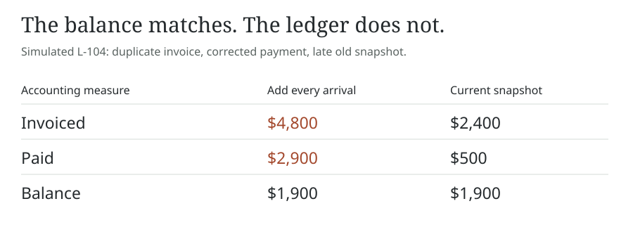

# Can this load be invoiced?

An integration release review that traces a trucking load from dispatch to accounting, checks the evidence behind an action and gives each release blocker an owner.

[Open the report](https://rhasan55.github.io/load-release/) · [SQL](ledger.sql) · [Python](engine.py) · [Portfolio](https://hasanmraja.com)



In this case, both approaches produce a $1,900 balance. One still doubles the invoice and overstates the payment. A balance alone is not a sufficient reconciliation check.

All events, identifiers and documents are simulated. No vendor accounts are connected. This is not an audit of Moldex or CENTRIX. The question came from the public role covering trucking integrations, AI and coordination of an existing development team. [Context](sources.md)

## What changes the answer

The report follows three failure cases over the same decision-time event set:

| Case | Result | What the team needs to do |
| --- | --- | --- |
| L-104: duplicate invoice and old payment arrive late | $2,400 invoice; $500 payment; $1,900 balance | Deduplicate deliveries and select the current revision per entity. Never add snapshot notifications as money. |
| L-105: location says destination, POD arrives after the decision | Hold at 18:00 UTC | Keep geofence context separate from delivery evidence. A later run may include the POD. |
| L-106: two values share one invoice revision | Hold both values | Accounting must resolve the source record; developers preserve and replay the evidence. |

Fourteen tests pass. The sample release still has three unresolved gates: an invoice conflict, an unmapped truck and a vendor reconciliation run that has not happened. Tests passing is not release approval.

## Reproduce

```bash
python3 engine.py
python3 -m unittest -v test_engine.py
python3 build_report.py
```

Python 3.10 or newer; standard library only. SQLite must support JSON functions and window functions. No packages, credentials, external calls or random model outputs are needed. Open `index.html` directly to use the report.

`engine.py` projects normalized snapshots using fleet-scoped identity mapping, event-ID deduplication, per-entity revisions and decision-time availability. `ledger.sql` independently recomputes the accounting ledger from the same inputs; a test reconciles its cents to Python. `validate_note` checks structured evidence claims and rejects unauthorized actions. It does not generate language or submit anything.

The project includes a [first-sprint plan](delivery-plan.md) with a 20-hour allocation, acceptance evidence, dependencies, source contracts and rollback. The report and README follow my earlier [launch measurement](https://rhasan55.github.io/did-it-grow/) and [denial review](https://rhasan55.github.io/claims-review/) work samples.

This is a local prototype, not a production integration. The fixture schema is not an Alvys, Samsara or QuickBooks payload. Live work needs vendor-specific adapters, durable ingress, signature checks, token isolation, reconciliation, controlled writes and operations sign-off.

[Methods](methods.md) · [Development checks](analysis-audit.md) · [Test output](test-results.txt)
